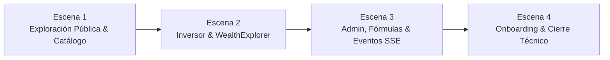

# Guion y Narración para la Demostración Técnica — Players Market
## Trabajo Práctico Integrador — CBO / UNQ Desarrollo de Aplicaciones

> [!NOTE]
> Este documento contiene el plan de vuelo, la hoja de ruta escénica y el libreto sugerido para realizar una defensa técnica impecable del proyecto **Players Market**. Está optimizado para una presentación en pareja (**Presentador 1** y **Presentadora 2**), destacando tanto la experiencia de usuario final como las decisiones de arquitectura, concurrencia, seguridad y calidad de código.

---

## 1. Tabla Resumen de Credenciales de Demostración

| Usuario | Correo / Login | Contraseña | Rol en Sistema | Propósito en la Demostración |
| :--- | :--- | :--- | :--- | :--- |
| **Inversor Experimentado** | `inversor@demo.com` (o `inversor`) | `Demo1234!` | `ROLE_USER` | Usuario con historial de 45 días, 15,000 CRD disponibles, 4 posiciones en portafolio con PnL positivo, reconstrucción en `WealthExplorer` y alertas SSE activas. |
| **Administrador del Mercado** | `admin@demo.com` (o `admin`) | `Admin1234!` | `ROLE_SUPERUSER` | Control central de fórmulas de valoración (`BALANCED` vs `OFFENSIVE`), recálculo global de cotizaciones, disparo reactivo de alertas y clave API para integraciones. |
| **Usuario Onboarding** | `nuevo@demo.com` (o `nuevo`) | `Nuevo1234!` | `ROLE_USER` | Usuario recién registrado con saldo limpio (0.00 CRD) y sin operaciones, ideal para demostrar en vivo la primera recarga de créditos y la primera compra de tokens. |

> [!TIP]
> **Autenticación flexible:** El sistema permite iniciar sesión indistintamente con el **correo electrónico** o con el **nombre de usuario**. Además, el Administrador posee la API Key preconfigurada:  
> `X-API-Key: cbo_live_demo_admin_api_key_2026_cbo`

---

## 2. Preparación Pre-Demo (Checklist de 3 Minutos)

Antes de invitar a los docentes a observar la pantalla, realizá este checklist:

### Paso 1: Levantar los contenedores de infraestructura
```bash
docker compose up -d
```
*(Asegura PostgreSQL en puerto `5432` y Redis en puerto `6379`).*

### Paso 2: Iniciar Backend Spring Boot
```bash
cd back
./mvnw spring-boot:run
```
*(Al iniciar, el componente `DemoDataSeeder` detectará automáticamente la base y poblará las estrategias, los 10 jugadores estrella, 75 días de cotizaciones, los 3 usuarios y el historial financiero conciliado).*

### Paso 3: Iniciar Frontend React
```bash
cd front
npm run dev
```

### Paso 4: Dejar preparadas las pestañas del navegador
1. **Pestaña 1 (Ventana Principal):** `http://localhost:5173/login` (aquí iniciaremos con `inversor@demo.com`).
2. **Pestaña 2 (Ventana Incógnito):** `http://localhost:5173/login` (reservada para el onboarding de `nuevo@demo.com`).
3. **Pestaña 3 (Herramientas / Swagger UI):** `http://localhost:8080/swagger-ui.html` (para ejecutar como Administrador el cambio de estrategia y el recálculo masivo).
4. **Pestaña 4 (Métricas y Calidad):** Dashboard local de SonarCloud / JaCoCo (`back/target/site/jacoco/index.html`).

---

## 3. Narración Paso a Paso (Storytelling por Escenas)



---

### ESCENA 1: Exploración Pública, Catálogo y Ranking de Cotizaciones
* **Objetivo:** Mostrar la robustez del modelo de datos, la integración de estadísticas deportivas (WhoScored / Football-Data), el rendimiento del catálogo con paginación y la caché en Redis del Ranking.
* **Roles:** Presentador 1 (habla) / Presentadora 2 (opera pantalla).

#### Qué hacer en pantalla:
1. Acceder a `http://localhost:5173/players`.
2. Mostrar la tabla de catálogo con jugadores reales de distintas ligas (Messi, Haaland, Mbappé, Bellingham, Rodri, Dibu Martínez, etc.).
3. Interactuar con los filtros en vivo: escribir "Manchester City" o filtrar por posición "FORWARD".
4. Hacer clic en **"Ver perfil"** de **Lionel Messi**:
   - Mostrar las estadísticas consolidadas (goles, asistencias, tiros, key passes, rating, minutos jugados).
   - Mostrar el gráfico interactivo de **Evolución histórica de cotizaciones** (`QuoteHistoryChart`): señalar cómo la curva dibuja los últimos 75 días con cambios de precio realistas.
5. Cerrar el modal y hacer clic en la pestaña **"Ranking"**:
   - Mostrar la tabla ordenada por cotización actual de mayor a menor.

#### Guion sugerido:
* **Presentador 1:**  
  *"Buenas tardes profesores. Para comenzar la defensa técnica de Players Market, queremos mostrarles el corazón de nuestro dominio: un mercado de tokens de jugadores de fútbol donde el valor de cada activo no es arbitrario ni estático, sino que deriva del rendimiento deportivo real recolectado mediante scraping y APIs de datos oficiales.*  
  *En pantalla estamos viendo el catálogo general. Implementamos paginación y búsqueda reactiva por múltiples criterios. Si abrimos el perfil de Lionel Messi, podemos ver la separación estricta entre las estadísticas deportivas crudas y el motor de valoración financiera.*  
  *Noten el gráfico de evolución de cotización: no tenemos datos planos; generamos un histórico diario al cierre UTC a lo largo de más de dos meses de actividad de mercado."*

* **Presentadora 2:**  
  *"Otro punto clave es la pestaña de Ranking que vemos ahora. Como el cálculo de cotizaciones y la ordenación de todos los jugadores activos puede ser costosa frente a miles de consultas concurrentes, implementamos una capa de caché en Redis bajo la clave `players::ranking`. Esto nos permite responder en menos de 5 milisegundos sin sobrecargar la base de datos relacional."*

---

### ESCENA 2: El Día a Día del Inversor y el Explorador Patrimonial (`WealthExplorer`)
* **Objetivo:** Demostrar la autenticación JWT, la lectura integral del Portafolio, la auditoría inmutable de transacciones y el algoritmo de reconciliación patrimonial histórica en el cliente.
* **Roles:** Presentadora 2 (habla) / Presentador 1 (opera pantalla).

#### Qué hacer en pantalla:
1. Ir a `/login` e ingresar con:
   - **Usuario:** `inversor@demo.com`
   - **Contraseña:** `Demo1234!`
2. En el Dashboard / Header, señalar el saldo disponible: `15.000,0000 CRD`.
3. Navegar a `/portfolio`:
   - Mostrar la tabla de posiciones: 20 tokens de Messi, 25 de Haaland, 30 de Bellingham y 149 de Emiliano Martínez.
   - Resaltar que todas las posiciones muestran rentabilidad positiva (**PnL verde**), con su costo base promedio y valor actual.
   - Mostrar el gráfico circular de alocación de activos (`PortfolioAllocationChart`).
4. **Momento Clave — Demostración de `WealthExplorer`:**
   - Ubicarse en el componente **"Período patrimonial"**.
   - Cambiar el selector entre:
     - **"30 días"** (muestra la evolución reciente).
     - **"90 días"** (revela el momento de la inyección de capital inicial y las primeras compras).
     - **"Todo el historial"** (panorama completo).
   - Explicar brevemente la rigurosidad matemática del algoritmo de reconstrucción.
5. Navegar a `/transactions`:
   - Mostrar el listado cronológico: la recarga original de 25.000 CRD, las compras sucesivas y la venta parcial de Messi (10 tokens a 110 CRD).
   - Mostrar cómo cada transacción almacena de forma inmutable `balanceBefore`, `balanceAfter`, `tokensBefore` y `tokensAfter`.
6. Volver a `/portfolio` y ejecutar una operación en vivo:
   - Vender 5 tokens de Messi o comprar 2 tokens adicionales de Haaland.
   - Mostrar cómo el modal valida fondos y stock en tiempo real y cómo se actualizan instantáneamente el saldo y el portafolio.
7. Navegar a `/alerts`:
   - Mostrar el indicador verde: `Conectado a notificaciones en tiempo real`.
   - Mostrar las alertas existentes: 1 `DISPARADA` (Messi) y 2 `ACTIVAS` (Martínez y Haaland).

#### Guion sugerido:
* **Presentadora 2:**  
  *"Ahora ingresamos con el perfil de un inversor real: `inversor@demo.com`. Al autenticarse, el backend emite un JWT firmado con HMAC-SHA256 que encapsula los claims del usuario de forma completamente stateless.*  
  *En su portfolio vemos que tiene un saldo líquido de 15.000 créditos y 4 posiciones activas diversificadas entre delanteros, mediocampistas y arquero. Todas reflejan métricas financieras profesionales: costo base promedio ponderado, valor actual de mercado y ganancia neta nominal y porcentual.*  
  *Pero queremos destacar especialmente el **Explorador Patrimonial (`WealthExplorer`)** que ven abajo a la derecha."*

* **Presentador 1:**  
  *"Muchos sistemas calculan el patrimonio histórico multiplicando el PnL actual hacia atrás, lo cual es financieramente erróneo si hubo compras o ventas intermedias. Nuestro equipo diseñó un algoritmo de reconciliación determinístico en UTC: toma el portfolio actual y va desarmando hacia atrás cada operación del historial inmutable, cruzándola con las cotizaciones exactas a cada fecha de corte.*  
  *Si cambio el selector de 30 días a 90 días o 'Todo el historial', el gráfico reconstruye con total fidelidad la recarga de 25.000 créditos de hace 45 días, las compras posteriores y las variaciones diarias de cotización sin un solo centavo de desfasaje."*

---

### ESCENA 3: Administración de Mercado, Cambio de Fórmulas y Alertas Reactivas (SSE)
* **Objetivo:** Mostrar la separación de privilegios (`SUPERUSER`), la flexibilidad de las estrategias de valuación (`Strategy Pattern`), el recálculo masivo y la propagación de eventos en tiempo real mediante Server-Sent Events.
* **Roles:** Presentador 1 (habla) / Presentadora 2 (opera pantalla partida o dos navegadores).

#### Qué hacer en pantalla:
1. **Configuración visual:** Dejar a la vista la pestaña del Inversor en la pantalla de `/alerts` (donde vemos la alerta ACTIVA de Dibu Martínez: *Disparar si cotización > 35.0000 CRD*).
2. Abrir la pestaña de **Swagger UI** (`http://localhost:8080/swagger-ui.html`):
   - En el botón superior **Authorize**, autenticar con el token de `admin@demo.com` (o usar la clave API `cbo_live_demo_admin_api_key_2026_cbo`).
   - Ir a `Admin Strategies` -> `GET /api/admin/strategies`:
     - Mostrar que existen dos estrategias: `OFFENSIVE` (ID 1, activa actualmente) y `BALANCED` (ID 2, inactiva).
     - Explicar las ponderaciones: en `OFFENSIVE`, los goles y tiros tienen peso preponderante (por eso Dibu Martínez cotiza a sólo 25.95 CRD). En `BALANCED`, los minutos, atajadas/tackles y rating pesan más.
   - Ejecutar `PATCH /api/admin/strategies/2/activate`:
     - Mostrar la respuesta `200 OK`: `BALANCED` queda activa.
   - Ir a `Quotes` -> `POST /api/quotes/recalculate` y hacer clic en **Execute**:
     - Mostrar la respuesta: tiempo de ejecución en milisegundos, estrategia aplicada e invalidación automática de caché.
3. **Volver inmediatamente a la pestaña de `/alerts` del Inversor:**
   - **¡Momento WOW!** En la interfaz del Inversor aparece la notificación instantánea sin recargar la página.
   - La alerta de Emiliano Martínez se actualiza a estado `DISPARADA` con el nuevo valor recalculado (~41.85 CRD, superando los 35 CRD objetivo).
   - La alerta de Haaland (< 100 CRD) también se dispara al bajar de 111.66 a 94.20 CRD.
   - Ir a `/ranking`: constatar que las cotizaciones cambiaron globalmente reflejando la nueva fórmula.

#### Guion sugerido:
* **Presentador 1:**  
  *"Pasamos ahora al rol de Administración del Mercado. En un sistema financiero, las reglas de valuación no pueden estar acopladas rígidamente en el código. Implementamos el patrón Strategy en Spring Boot, lo que permite al Administrador cambiar las fórmulas matemáticas del mercado.*  
  *Actualmente rige la fórmula `OFFENSIVE`. Bajo esta fórmula, los delanteros como Haaland y Mbappé están inflados, mientras que un arquero de élite como el Dibu Martínez cotiza a tan solo 25,95 créditos.*  
  *Noten que nuestro Inversor tiene una Alerta de Precio activa configurada: 'Avisarme si el Dibu Martínez supera los 35 créditos'.*  
  *Ahora, mi compañera va a ejecutar desde la API de administración la activación de la estrategia `BALANCED` y el recálculo masivo global."*

* **Presentadora 2 (ejecuta el endpoint):**  
  *"Al ejecutar el recálculo masivo, el backend procesa a todos los jugadores activos en una única transacción de lectura/escritura, calcula los nuevos precios según los pesos equilibrados, persiste las cotizaciones, invalida la caché de Redis y publica un evento interno de dominio `QuotesRecalculatedEvent`.*  
  *Como ven en pantalla en la sesión del inversor, **sin haber hecho F5**, el canal de Server-Sent Events (SSE) notificó al navegador del usuario en tiempo real que su alerta se disparó, ya que el Dibu Martínez saltó a 41,85 créditos debido a su alto rating y minutos jugados."*

---

### ESCENA 4: Onboarding Rápido y Cierre de Arquitectura / Calidad
* **Objetivo:** Mostrar la facilidad de onboarding para un nuevo usuario y cerrar con una síntesis técnica de alto impacto (concurrencia, seguridad y SonarCloud).
* **Roles:** Ambos presentadores.

#### Qué hacer en pantalla:
1. Abrir la ventana de **Incógnito**:
   - Iniciar sesión con: `nuevo@demo.com` / `Nuevo1234!`.
   - Mostrar que ingresa con saldo `0,0000 CRD` y portafolio vacío.
   - Realizar una recarga de saldo de `5.000,0000 CRD`.
   - Ir al catálogo o ranking y comprar 10 tokens de Rodri o Bellingham.
   - Mostrar la inmediatez y fluidez del flujo de onboarding.
2. Abrir brevemente la pestaña del reporte de **JaCoCo / SonarCloud**:
   - Mostrar las métricas de cobertura y calidad de código.

#### Guion sugerido:
* **Presentadora 2:**  
  *"Para verificar el ciclo de vida completo de un usuario, tenemos al usuario `nuevo@demo.com`. Inicia con su cuenta limpia, realiza su primera carga de fondos e inmediatamente puede adquirir sus primeros tokens en el mercado. Todo el flujo cuenta con validaciones de importe, manejo de estados inciertos en frontend y confirmaciones accesibles."*

* **Presentador 1 (Cierre Técnico Final):**  
  *"Para concluir, queremos sintetizar los cuatro pilares no funcionales que guiaron nuestro desarrollo:
  1. **Control de Concurrencia Estricto:** En el backend, las órdenes de compra y venta utilizan bloqueo pesimista (`PESSIMISTIC_WRITE`) sobre las posiciones del creador de mercado y de los usuarios. Esto garantiza que nunca se produzca venta en corto ni sobreventa de tokens ante compras simultáneas concurrentes.
  2. **Seguridad y Trazabilidad:** Arquitectura REST 100% stateless con JWT para usuarios de navegador y autenticación por API Key con hash SHA-256 para automatizaciones. Toda operación financiera genera un registro auditable e inmutable en la tabla `transactions`.
  3. **Eventos y Tiempo Real:** Desacoplamiento total entre el motor de cálculo de precios y el sistema de alertas mediante eventos de Spring y Server-Sent Events unidireccionales de bajo consumo.
  4. **Calidad de Código y Testing:** Contamos con más de 200 pruebas unitarias y de integración en backend y más de 140 pruebas en frontend con Vitest, manteniendo la cobertura de código exigida por la cátedra y SonarCloud en verde, sin deuda técnica ni code smells.*  
  *Quedamos a disposición de los profesores para cualquier pregunta o para profundizar en cualquier línea de código que deseen revisar. ¡Muchas gracias!"*

---

## 4. Preguntas Frecuentes de la Cátedra (Cheat Sheet para Responder)

### ¿Cómo manejan la concurrencia al comprar tokens?
> *"En `OrderService`, cuando un usuario ejecuta una compra, bloqueamos pesimistamente con `findByUserIdAndPlayerIdWithLock` la posición del creador de mercado (Superuser) y del comprador dentro de una transacción con aislamiento `READ_COMMITTED`. Esto previene race conditions y garantiza que la resta de stock y la deducción de saldo sean atómicas e indivisibles."*

### ¿Por qué eligieron Server-Sent Events (SSE) en lugar de WebSockets?
> *"Porque las alertas de precios son estrictamente unidireccionales (del servidor al cliente). WebSockets agrega sobrecarga de protocolo bidireccional y complejidad de heartbeat/reconexión innecesaria para este caso de uso. SSE corre sobre HTTP estándar, atraviesa proxies y firewalls sin configuración especial y se reconecta de manera nativa y transparente."*

### ¿Cómo garantizan que las cotizaciones históricas y el patrimonio concilien?
> *"En el backend, cada transacción almacena explícitamente el saldo anterior y posterior, así como la cantidad de tokens antes y después. En el frontend, el módulo `financial.js` valida que la suma de tokens multiplicada por la cotización de cierre UTC coincida exactamente con la diferencia de saldo de cada día. Si existiera cualquier inconsistencia de datos, el explorador lo detecta y lo reporta en lugar de dibujar datos ficticios."*

### ¿Cómo evitan que el seeder duplique datos al reiniciar el servidor?
> *"El `DemoDataSeeder` está condicionado a la propiedad `app.demo-seed.enabled=true` (activa en entornos locales y Docker, pero explícitamente desactivada en los perfiles `test`, `unit` y `e2e`). Además, implementa idempotencia verificando `userRepository.existsByEmail('inversor@demo.com')`: si los datos ya fueron generados, el proceso se omite limpiamente en 1 milisegundo sin alterar la base de datos existente."*
