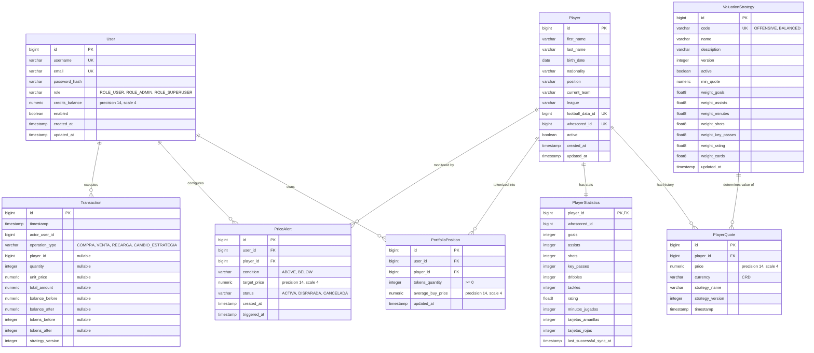
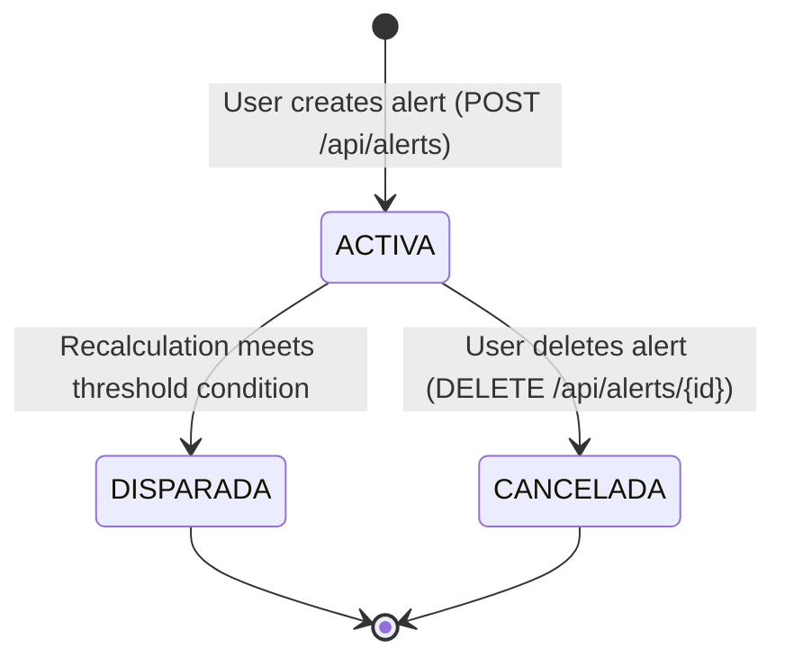
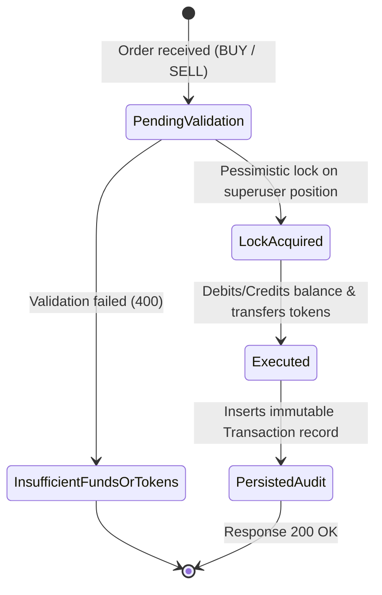

# Data Model: Entrega 2 Backend Core & Real-Time Engine

**Feature**: `004-entrega2-core`  
**Date**: 2026-10-24  
**Target Storage**: PostgreSQL 15+ (JPA / Hibernate 6)

---

## Entity Relationship Overview

---

## Detailed Entity Specifications

### 1. `User` (Updated)
Represents a platform actor (regular user, admin, or superuser).

| Column | Type | Constraints | Description |
|---|---|---|---|
| `id` | `BIGSERIAL` | `PRIMARY KEY` | Unique user identifier |
| `username` | `VARCHAR(50)` | `NOT NULL, UNIQUE` | Unique handle |
| `email` | `VARCHAR(100)` | `NOT NULL, UNIQUE` | Contact email |
| `password_hash` | `VARCHAR(100)` | `NOT NULL` | BCrypt encrypted password |
| `role` | `VARCHAR(20)` | `NOT NULL` | Enum: `ROLE_USER`, `ROLE_ADMIN`, `ROLE_SUPERUSER` |
| `credits_balance` | `NUMERIC(14,4)` | `NOT NULL, DEFAULT 0.0000, CHECK (credits_balance >= 0)` | Available trading credits balance |
| `enabled` | `BOOLEAN` | `NOT NULL, DEFAULT TRUE` | Active user account flag |
| `created_at` | `TIMESTAMP` | `NOT NULL, UP-TO-DATE UTC` | Account creation timestamp |
| `updated_at` | `TIMESTAMP` | `NOT NULL, UP-TO-DATE UTC` | Last profile update timestamp |

---

### 2. `ValuationStrategy` (New)
Configuration of the mathematical valuation formula applied to player statistics.

| Column | Type | Constraints | Description |
|---|---|---|---|
| `id` | `BIGSERIAL` | `PRIMARY KEY` | Identifier |
| `code` | `VARCHAR(30)` | `NOT NULL, UNIQUE` | Stable code (e.g. `OFFENSIVE`, `BALANCED`) |
| `name` | `VARCHAR(100)` | `NOT NULL` | Display name (e.g. "Rendimiento Ofensivo") |
| `description` | `VARCHAR(255)` | `NULLABLE` | Short explanation of the formula |
| `version` | `INTEGER` | `NOT NULL, DEFAULT 1` | Incremental version number |
| `active` | `BOOLEAN` | `NOT NULL, DEFAULT FALSE` | Flag indicating the single active strategy in the system |
| `min_quote` | `NUMERIC(14,4)` | `NOT NULL, DEFAULT 1.0000` | Guaranteed floor quote for zero stats |
| `weight_goals` | `FLOAT8` | `NOT NULL, DEFAULT 1.0` | Weight for goals |
| `weight_assists` | `FLOAT8` | `NOT NULL, DEFAULT 0.8` | Weight for assists |
| `weight_minutes` | `FLOAT8` | `NOT NULL, DEFAULT 0.01` | Weight for played minutes |
| `weight_shots` | `FLOAT8` | `NOT NULL, DEFAULT 0.1` | Weight for total shots |
| `weight_key_passes` | `FLOAT8` | `NOT NULL, DEFAULT 0.2` | Weight for key passes |
| `weight_rating` | `FLOAT8` | `NOT NULL, DEFAULT 1.5` | Weight for match rating |
| `weight_cards` | `FLOAT8` | `NOT NULL, DEFAULT -0.5` | Weight penalty for yellow/red cards |
| `updated_at` | `TIMESTAMP` | `NOT NULL` | Timestamp of activation/weight change |

---

### 3. `PlayerQuote` (Updated)
Immutable historical valuation point for a player at a specific time.

| Column | Type | Constraints | Description |
|---|---|---|---|
| `id` | `BIGSERIAL` | `PRIMARY KEY` | Identifier |
| `player_id` | `BIGINT` | `NOT NULL, FK -> players(id)` | Target player |
| `price` | `NUMERIC(14,4)` | `NOT NULL, CHECK (price >= 1.0)` | Calculated quote value |
| `currency` | `VARCHAR(3)` | `NOT NULL, DEFAULT 'CRD'` | Currency code |
| `strategy_name` | `VARCHAR(100)` | `NOT NULL` | Name of strategy applied |
| `strategy_version` | `INTEGER` | `NOT NULL` | Version of strategy applied |
| `timestamp` | `TIMESTAMP` | `NOT NULL` | Calculation UTC timestamp |

*Indexes*:
- `idx_player_quotes_player_timestamp (player_id, timestamp DESC)`

---

### 4. `PortfolioPosition` (New)
Tracks user ownership of tokens for a given player.

| Column | Type | Constraints | Description |
|---|---|---|---|
| `id` | `BIGSERIAL` | `PRIMARY KEY` | Identifier |
| `user_id` | `BIGINT` | `NOT NULL, FK -> users(id)` | Position owner |
| `player_id` | `BIGINT` | `NOT NULL, FK -> players(id)` | Tokenized player |
| `tokens_quantity` | `INTEGER` | `NOT NULL, CHECK (tokens_quantity >= 0 AND tokens_quantity <= 100)` | Number of tokens held |
| `average_buy_price` | `NUMERIC(14,4)` | `NOT NULL, DEFAULT 0.0000` | Weighted average purchase price |
| `updated_at` | `TIMESTAMP` | `NOT NULL` | Timestamp of last position adjustment |

*Constraints & Invariants*:
- `UNIQUE (user_id, player_id)`
- $\forall p \in \text{Players}: \sum_{u} \text{tokens\_quantity}(u, p) = 100$

---

### 5. `Transaction` (New / Core Audit)
Strictly immutable audit ledger of all balance and token operations.

| Column | Type | Constraints | Description |
|---|---|---|---|
| `id` | `BIGSERIAL` | `PRIMARY KEY` | Identifier |
| `timestamp` | `TIMESTAMP` | `NOT NULL` | Execution UTC timestamp |
| `actor_user_id` | `BIGINT` | `NOT NULL` | ID of user who executed the operation |
| `operation_type` | `VARCHAR(30)` | `NOT NULL` | `COMPRA`, `VENTA`, `RECARGA`, `CAMBIO_ESTRATEGIA` |
| `player_id` | `BIGINT` | `NULLABLE` | Player ID (NULL in `RECARGA` and `CAMBIO_ESTRATEGIA`) |
| `quantity` | `INTEGER` | `NULLABLE` | Tokens traded (NULL in `RECARGA` and `CAMBIO_ESTRATEGIA`) |
| `unit_price` | `NUMERIC(14,4)` | `NULLABLE` | Quote applied (NULL in `RECARGA` and `CAMBIO_ESTRATEGIA`) |
| `total_amount` | `NUMERIC(14,4)` | `NULLABLE` | Total credits value (NULL in `CAMBIO_ESTRATEGIA`) |
| `balance_before` | `NUMERIC(14,4)` | `NULLABLE` | User balance before op (NULL in `CAMBIO_ESTRATEGIA`) |
| `balance_after` | `NUMERIC(14,4)` | `NULLABLE` | User balance after op (NULL in `CAMBIO_ESTRATEGIA`) |
| `tokens_before` | `INTEGER` | `NULLABLE` | Position tokens before op |
| `tokens_after` | `INTEGER` | `NULLABLE` | Position tokens after op |
| `strategy_version` | `INTEGER` | `NOT NULL` | Active strategy version when transaction executed |

*Immutability Policy*:
- Entity marked with `@Immutable` (Hibernate) or custom `@PreUpdate` / `@PreRemove` throwing `UnsupportedOperationException`.

---

### 6. `PriceAlert` (New / Feature Adicional)
Price threshold monitoring for push notification.

| Column | Type | Constraints | Description |
|---|---|---|---|
| `id` | `BIGSERIAL` | `PRIMARY KEY` | Identifier |
| `user_id` | `BIGINT` | `NOT NULL, FK -> users(id)` | Subscribed user |
| `player_id` | `BIGINT` | `NOT NULL, FK -> players(id)` | Monitored player |
| `condition` | `VARCHAR(10)` | `NOT NULL` | `ABOVE` or `BELOW` |
| `target_price` | `NUMERIC(14,4)` | `NOT NULL, CHECK (target_price > 0)` | Threshold price |
| `status` | `VARCHAR(20)` | `NOT NULL, DEFAULT 'ACTIVA'` | `ACTIVA`, `DISPARADA`, `CANCELADA` |
| `created_at` | `TIMESTAMP` | `NOT NULL` | Subscription creation timestamp |
| `triggered_at` | `TIMESTAMP` | `NULLABLE` | Timestamp when threshold was met |

---

## State Transition Diagrams

### PriceAlert Lifecycle

### Token Order Transaction Lifecycle

