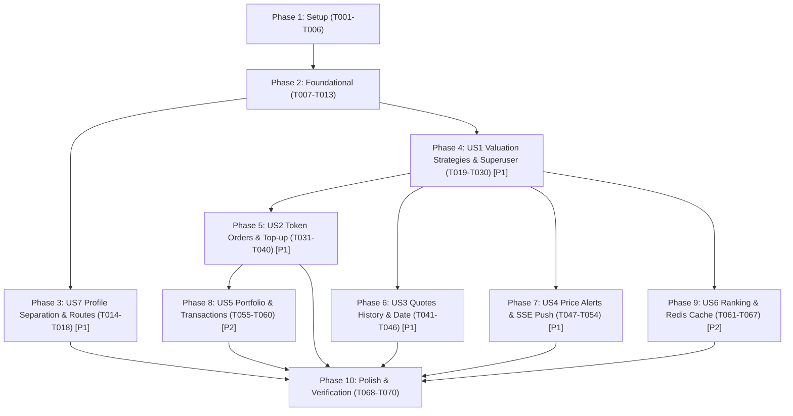

# Tasks: Entrega 2 Backend Core & Real-Time Engine

**Input**: Design documents from `specs/004-entrega2-core/` (`plan.md`, `spec.md`, `data-model.md`, `research.md`, `contracts/`, `quickstart.md`)  
**Feature Branch**: `feature/004-entrega2-core-update`  
**Prerequisites**: `plan.md`, `spec.md`, `data-model.md`, `contracts/`, `research.md`, `quickstart.md`  
**Organization**: Tasks are grouped by setup, foundation, and individual user stories (ordered by priority: P1 stories first, then P2 stories) to enable independent implementation and testing of each increment.

---

## Format: `[ID] [P?] [Story] Description`
- **[P]**: Can run in parallel (different files, no dependencies on uncompleted tasks)
- **[Story]**: Mapped user story (`[US1]`, `[US2]`, `[US3]`, `[US4]`, `[US7]`, `[US5]`, `[US6]`)
- Explicit and complete file paths are specified for every task.

---

## Phase 1: Setup (Shared Infrastructure & Dependencies)

**Purpose**: Project dependency configuration, testing profile isolation, and Redis cache setup.

- [ ] T001 Add Testcontainers PostgreSQL and Spring Data Redis dependencies in `back/pom.xml`, and remove H2 dependency
- [ ] T002 Configure Maven profiles `unit` (surefire, mocks) and `e2e` (failsafe, Testcontainers) in `back/pom.xml`
- [ ] T003 [P] Create Redis cache configuration and connection bean in `back/src/main/java/com/cbo/players/config/RedisCacheConfig.java`
- [ ] T004 [P] Configure asynchronous task execution and thread pool for SSE/events in `back/src/main/java/com/cbo/players/config/AsyncConfig.java`
- [ ] T005 [P] Setup profile-specific properties in `back/src/main/resources/application.yml`, `back/src/test/resources/application-unit.yml`, and `back/src/test/resources/application-e2e.yml`
- [ ] T006 Create base reusable Testcontainers test harness in `back/src/test/java/com/cbo/players/e2e/AbstractE2ETest.java`

---

## Phase 2: Foundational (Blocking Prerequisites)

**Purpose**: Core model extensions, routing sanitation, error codes, and audit entities required by all user stories.

- [ ] T007 Sanitize existing controllers to eliminate `/v1` prefix in `back/src/main/java/com/cbo/players/controller/AuthController.java` and `back/src/main/java/com/cbo/players/controller/PlayerController.java`
- [ ] T008 [P] Extend `UserRole` enum with `ROLE_SUPERUSER` in `back/src/main/java/com/cbo/players/model/UserRole.java`
- [ ] T009 [P] Extend `User` entity with `creditsBalance` (default 0.0) and role helper methods in `back/src/main/java/com/cbo/players/model/User.java`
- [ ] T010 [P] Define functional error codes (`INSUFFICIENT_FUNDS`, `INSUFFICIENT_TOKENS_AVAILABLE`, `INSUFFICIENT_TOKEN_BALANCE`, `INVALID_AMOUNT`, `STRATEGY_NOT_FOUND`, `ACCESS_DENIED`) in `back/src/main/java/com/cbo/players/exception/ErrorCode.java`
- [ ] T011 Update `GlobalExceptionHandler` to produce RFC 7807 `ProblemDetail` responses in Spanish in `back/src/main/java/com/cbo/players/exception/GlobalExceptionHandler.java`
- [ ] T012 Create immutable audit entity `Transaction` with operation types (`COMPRA`, `VENTA`, `RECARGA`, `CAMBIO_ESTRATEGIA`) and audit fields in `back/src/main/java/com/cbo/players/model/Transaction.java`
- [ ] T013 Create read/insert repository for audit transactions in `back/src/main/java/com/cbo/players/repository/TransactionRepository.java`

**Checkpoint**: Foundation ready — User story implementation can now begin.

---

## Phase 3: User Story 7 - Separación de Profiles (`unit` y `e2e`) y Saneamiento de Rutas (Priority: P1)

**Goal**: Guarantee independent execution of unit and e2e testing suites on PostgreSQL without H2 and verify all endpoints operate without `/v1`.

**Independent Test**: Run `./mvnw test -Punit` to verify pure mocked unit tests pass without starting containers; run `./mvnw verify -Pe2e` to verify Testcontainers PostgreSQL starts and runs integration tests; verify all existing endpoint paths respond without `/v1`.

### Tests for User Story 7
- [ ] T014 [P] [US7] Create unit suite validation test in `back/src/test/java/com/cbo/players/unit/TestingProfileUnitTest.java`
- [ ] T015 [P] [US7] Create E2E route sanitation test extending `AbstractE2ETest` in `back/src/test/java/com/cbo/players/e2e/RouteSanitationE2ETest.java`

### Implementation for User Story 7
- [ ] T016 [US7] Update `SecurityConfig.java` to secure routes under `/api/**` without `/v1` in `back/src/main/java/com/cbo/players/security/SecurityConfig.java`
- [ ] T017 [US7] Update OpenApi documentation configuration paths to remove `/v1` in `back/src/main/java/com/cbo/players/config/OpenApiConfig.java`
- [ ] T018 [US7] Refactor existing unit tests to align with sanitized `/api/**` paths in `back/src/test/java/com/cbo/players/controller/AuthControllerTest.java` and `PlayerControllerTest.java`

**Checkpoint**: User Story 7 complete and validated.

---

## Phase 4: User Story 1 - Estrategias de Valoración y Control por Superusuario (Priority: P1) 🎯 MVP

**Goal**: Implement dynamic valuation strategies, superuser activation endpoint (`PATCH /api/admin/strategies/{id}/activate`), and global recalculation (`POST /api/quotes/recalculate`).

**Independent Test**: Authenticate as superuser and regular user; verify `PATCH /api/admin/strategies/{id}/activate` returns 200 for superuser and 403 for regular user; invoke `POST /api/quotes/recalculate` and verify all active players receive a new `PlayerQuote` record with the active strategy and version.

### Tests for User Story 1
- [ ] T019 [P] [US1] Unit test for valuation formulas (`OffensiveValuationFormula`, `BalancedValuationFormula`) in `back/src/test/java/com/cbo/players/unit/ValuationFormulaTest.java`
- [ ] T020 [P] [US1] Integration test for superuser strategy activation and recalculation in `back/src/test/java/com/cbo/players/e2e/AdminStrategyRecalculationE2ETest.java`

### Implementation for User Story 1
- [ ] T021 [P] [US1] Create `ValuationStrategy` entity with dynamic weights in `back/src/main/java/com/cbo/players/model/ValuationStrategy.java`
- [ ] T022 [P] [US1] Extend `PlayerQuote` entity with `strategyName` and `strategyVersion` in `back/src/main/java/com/cbo/players/model/PlayerQuote.java`
- [ ] T023 [P] [US1] Create `ValuationStrategyRepository` in `back/src/main/java/com/cbo/players/repository/ValuationStrategyRepository.java`
- [ ] T024 [P] [US1] Implement `ValuationFormula` interface and implementations in `back/src/main/java/com/cbo/players/service/formula/ValuationFormula.java`, `OffensiveValuationFormula.java`, and `BalancedValuationFormula.java`
- [ ] T025 [US1] Implement `ValuationStrategyService` for strategy registration, activation, and weight management in `back/src/main/java/com/cbo/players/service/ValuationStrategyService.java`
- [ ] T026 [US1] Create domain event `QuotesRecalculatedEvent` in `back/src/main/java/com/cbo/players/event/QuotesRecalculatedEvent.java`
- [ ] T027 [US1] Implement `QuoteCalculationService` to compute quotes for all active players and publish `QuotesRecalculatedEvent` in `back/src/main/java/com/cbo/players/service/QuoteCalculationService.java`
- [ ] T028 [US1] Create DTOs for strategy activation and quote recalculation in `back/src/main/java/com/cbo/players/dto/response/StrategyResponseDto.java` and `QuoteRecalculateResponseDto.java`
- [ ] T029 [US1] Implement `AdminStrategyController` exposing `PATCH /api/admin/strategies/{id}/activate` with superuser security in `back/src/main/java/com/cbo/players/controller/AdminStrategyController.java`
- [ ] T030 [US1] Implement `QuoteController` exposing `POST /api/quotes/recalculate` in `back/src/main/java/com/cbo/players/controller/QuoteController.java`

**Checkpoint**: User Story 1 complete and independently testable.

---

## Phase 5: User Story 2 - Mercado de Tokens y Recarga Simulada de Créditos (Priority: P1)

**Goal**: Atomic buy and sell orders (`POST /api/orders/buy`, `POST /api/orders/sell`) guaranteeing the 100-token invariant per player via pessimistic write locking, plus simulated credit top-up (`POST /api/users/{id}/credits/topup`).

**Independent Test**: Top-up 100 credits for a user with balance 0; buy 4 tokens of a player and verify balance decreases by cost, superuser pool has 96 tokens, and transaction is logged; sell 2 tokens and verify balance increases and superuser pool has 98 tokens; attempt buying with insufficient credits or selling without tokens and verify 400 Bad Request.

### Tests for User Story 2
- [ ] T031 [P] [US2] Unit test for order validation and PnL average cost calculation in `back/src/test/java/com/cbo/players/unit/OrderServiceTest.java`
- [ ] T032 [P] [US2] Concurrency test verifying 100-token invariant under parallel buy requests in `back/src/test/java/com/cbo/players/e2e/OrderConcurrencyE2ETest.java`
- [ ] T033 [P] [US2] Integration test for credit top-up and validation rules in `back/src/test/java/com/cbo/players/e2e/CreditsTopupE2ETest.java`

### Implementation for User Story 2
- [ ] T034 [P] [US2] Create `PortfolioPosition` entity representing `(user_id, player_id)` token holdings in `back/src/main/java/com/cbo/players/model/PortfolioPosition.java`
- [ ] T035 [P] [US2] Create `PortfolioPositionRepository` with pessimistic write lock query in `back/src/main/java/com/cbo/players/repository/PortfolioPositionRepository.java`
- [ ] T036 [P] [US2] Create request and response DTOs for orders and top-up in `back/src/main/java/com/cbo/players/dto/request/OrderRequestDto.java`, `CreditsTopupRequestDto.java`, and `back/src/main/java/com/cbo/players/dto/response/OrderResponseDto.java`, `CreditsTopupResponseDto.java`
- [ ] T037 [US2] Implement `WalletService` for balance operations and top-up logging in `back/src/main/java/com/cbo/players/service/WalletService.java`
- [ ] T038 [US2] Implement `OrderService` for atomic buy/sell operations and immutable `Transaction` generation in `back/src/main/java/com/cbo/players/service/OrderService.java`
- [ ] T039 [US2] Implement `OrderController` exposing `POST /api/orders/buy` and `POST /api/orders/sell` in `back/src/main/java/com/cbo/players/controller/OrderController.java`
- [ ] T040 [US2] Implement credit top-up endpoint `POST /api/users/{id}/credits/topup` in `back/src/main/java/com/cbo/players/controller/UserController.java`

**Checkpoint**: User Story 2 complete and independently testable.

---

## Phase 6: User Story 3 - Consulta de Cotización Actual, Histórica Paginada y por Fecha (Priority: P1)

**Goal**: Expose `GET /api/players/{id}/quotes` supporting pagination (`page`, `size`) and optional query parameter `?date=YYYY-MM-DD`.

**Independent Test**: Seed multiple historical quotes for a player; query `GET /api/players/{id}/quotes` with `page=0&size=20` and verify pagination metadata; query with `?date=YYYY-MM-DD` and verify it returns the single quote effective at that date without pagination.

### Tests for User Story 3
- [ ] T041 [P] [US3] Unit test for date-effective quote search in `back/src/test/java/com/cbo/players/unit/PlayerQuoteServiceTest.java`
- [ ] T042 [P] [US3] Integration test for paginated quotes and date query in `back/src/test/java/com/cbo/players/e2e/PlayerQuotesPaginationE2ETest.java`

### Implementation for User Story 3
- [ ] T043 [P] [US3] Add paginated and date-effective queries to `PlayerQuoteRepository` in `back/src/main/java/com/cbo/players/repository/PlayerQuoteRepository.java`
- [ ] T044 [P] [US3] Create response DTOs for historical and date-effective quotes in `back/src/main/java/com/cbo/players/dto/response/PlayerQuoteResponseDto.java` and `PagedResponseDto.java`
- [ ] T045 [US3] Implement quote query logic in `back/src/main/java/com/cbo/players/service/PlayerQuoteService.java`
- [ ] T046 [US3] Expose `GET /api/players/{id}/quotes` handling both pagination and `date` parameter in `back/src/main/java/com/cbo/players/controller/PlayerController.java`

**Checkpoint**: User Story 3 complete and independently testable.

---

## Phase 7: User Story 4 - Feature Adicional: Motor de Alertas de Precios y Push en Vivo vía SSE (Priority: P1)

**Goal**: Provide price alerts management (`POST /api/alerts`, `GET /api/alerts`, `DELETE /api/alerts/{id}`) and persistent SSE push streaming (`GET /api/alerts/stream` via `SseEmitter`).

**Independent Test**: Connect to `GET /api/alerts/stream` with client; create an alert for player quote `ABOVE` threshold; run recalculation to exceed threshold; verify SSE client receives `price-alert` event payload within 2 seconds and alert status transitions to `DISPARADA`.

### Tests for User Story 4
- [ ] T047 [P] [US4] Unit test for price alert condition evaluator in `back/src/test/java/com/cbo/players/unit/AlertServiceTest.java`
- [ ] T048 [P] [US4] E2E integration test for SSE streaming connection and event dispatch in `back/src/test/java/com/cbo/players/e2e/AlertSseStreamE2ETest.java`

### Implementation for User Story 4
- [ ] T049 [P] [US4] Create `PriceAlert` entity and enums `AlertCondition` (`ABOVE`, `BELOW`) and `AlertStatus` (`ACTIVA`, `DISPARADA`, `CANCELADA`) in `back/src/main/java/com/cbo/players/model/PriceAlert.java`
- [ ] T050 [P] [US4] Create `PriceAlertRepository` in `back/src/main/java/com/cbo/players/repository/PriceAlertRepository.java`
- [ ] T051 [P] [US4] Create request and response DTOs for alerts in `back/src/main/java/com/cbo/players/dto/request/CreateAlertRequestDto.java` and `back/src/main/java/com/cbo/players/dto/response/PriceAlertResponseDto.java`
- [ ] T052 [US4] Implement `AlertStreamService` managing active `SseEmitter` subscriptions, heartbeat pings, and cleanup in `back/src/main/java/com/cbo/players/service/AlertStreamService.java`
- [ ] T053 [US4] Implement `AlertService` with `@EventListener` on `QuotesRecalculatedEvent` evaluating conditions and dispatching SSE events in `back/src/main/java/com/cbo/players/service/AlertService.java`
- [ ] T054 [US4] Implement `AlertController` exposing `/api/alerts` and `/api/alerts/stream` in `back/src/main/java/com/cbo/players/controller/AlertController.java`

**Checkpoint**: User Story 4 complete and independently testable.

---

## Phase 8: User Story 5 - Endpoints de Portfolio e Historial Auditable de Transacciones (Priority: P2)

**Goal**: Expose consolidated user portfolio (`GET /api/users/{id}/portfolio`) with financial metrics and transaction history (`GET /api/users/{id}/transactions`).

**Independent Test**: Perform top-up, buy, and sell operations; query `GET /api/users/{id}/portfolio` and verify tokens quantity, average buy price, current valuation, and PnL; query `GET /api/users/{id}/transactions` and verify complete chronologically ordered ledger.

### Tests for User Story 5
- [ ] T055 [P] [US5] Unit test for portfolio PnL and valuation aggregation in `back/src/test/java/com/cbo/players/unit/PortfolioServiceTest.java`
- [ ] T056 [P] [US5] Integration test for portfolio and transaction ledger endpoints in `back/src/test/java/com/cbo/players/e2e/PortfolioTransactionsE2ETest.java`

### Implementation for User Story 5
- [ ] T057 [P] [US5] Create DTOs for portfolio positions and transaction history in `back/src/main/java/com/cbo/players/dto/response/PortfolioResponseDto.java` and `TransactionResponseDto.java`
- [ ] T058 [US5] Implement `PortfolioService` calculating total invested, current valuation, and nominal/percentage PnL in `back/src/main/java/com/cbo/players/service/PortfolioService.java`
- [ ] T059 [US5] Implement transaction query service in `back/src/main/java/com/cbo/players/service/TransactionService.java`
- [ ] T060 [US5] Expose `GET /api/users/{id}/portfolio` and `GET /api/users/{id}/transactions` in `back/src/main/java/com/cbo/players/controller/UserController.java`

**Checkpoint**: User Story 5 complete and independently testable.

---

## Phase 9: User Story 6 - Ranking con Caché Redis y Scheduler Semanal (Priority: P2)

**Goal**: Expose `GET /api/players/ranking` sorted by current quote under active strategy with Redis caching, and configure weekly automatic recalculation via `@Scheduled`.

**Independent Test**: Query `GET /api/players/ranking` and verify response is ordered descending by quote and stored in Redis; recalculate quotes and verify Redis cache is evicted; verify weekly `@Scheduled` cron job triggers quote recalculation.

### Tests for User Story 6
- [ ] T061 [P] [US6] Unit test for ranking service sorting and cache eviction in `back/src/test/java/com/cbo/players/unit/RankingServiceTest.java`
- [ ] T062 [P] [US6] Integration test for Redis cache hit and invalidation on recalculation in `back/src/test/java/com/cbo/players/e2e/RankingRedisCacheE2ETest.java`

### Implementation for User Story 6
- [ ] T063 [P] [US6] Create DTO for ranking items in `back/src/main/java/com/cbo/players/dto/response/PlayerRankingResponseDto.java`
- [ ] T064 [US6] Implement `RankingService` with `@Cacheable(cacheNames = "players::ranking")` in `back/src/main/java/com/cbo/players/service/RankingService.java`
- [ ] T065 [US6] Configure `@CacheEvict(cacheNames = {"players::catalog", "players::ranking"}, allEntries = true)` in `QuoteCalculationService.java`
- [ ] T066 [US6] Update `CatalogScheduler` to trigger weekly quote recalculation and external stats sync in `back/src/main/java/com/cbo/players/service/CatalogScheduler.java`
- [ ] T067 [US6] Expose `GET /api/players/ranking` in `back/src/main/java/com/cbo/players/controller/PlayerController.java`

**Checkpoint**: User Story 6 complete and independently testable.

---

## Phase 10: Polish & Cross-Cutting Concerns

**Purpose**: System verification, API documentation validation, and code quality hardening.

- [ ] T068 [P] Update OpenAPI documentation with new schemas and endpoints in `back/src/main/java/com/cbo/players/config/OpenApiConfig.java`
- [ ] T069 [P] Verify SonarCloud compliance and clean up code smells/unused imports across all modified classes in `back/`
- [ ] T070 Execute complete validation run following `quickstart.md` (`./mvnw test -Punit` and `./mvnw verify -Pe2e`)

---

## Dependencies & Execution Order

### Phase Dependencies

### User Story Dependencies
1. **US7 (P1)**: Can run immediately after Foundational. Sane and validates base testing profiles and `/api/**` routes.
2. **US1 (P1)**: Can run after Foundational. Blocks US2, US3, US4, US6 because token orders, alerts, ranking, and quotes history all depend on calculated quotes.
3. **US2 (P1)**: Depends on US1 (requires valid quotes to execute buy/sell orders). Blocks US5 (portfolio positions depend on orders).
4. **US3 (P1)**: Depends on US1 (queries historical quotes created by recalculation).
5. **US4 (P1)**: Depends on US1 (alert evaluation triggers on `QuotesRecalculatedEvent`).
6. **US5 (P2)**: Depends on US2 (portfolio summarizes user token purchases and sales).
7. **US6 (P2)**: Depends on US1 (ranking sorts players by current quote and invalidates cache on recalculation).

---

## Implementation Strategy

### MVP First (Phases 1, 2, 3, and 4)
1. Complete **Phase 1** (Setup) & **Phase 2** (Foundational).
2. Complete **Phase 3** (US7 Profile Separation) ensuring `./mvnw test -Punit` and `./mvnw verify -Pe2e` pass.
3. Complete **Phase 4** (US1 Valuation Strategy Engine & Superuser Control).
4. **Validate MVP**: Recalculate quotes, activate strategy B, verify DB records and tests.

### Incremental Delivery Order
- **Increment 1**: US7 Testing profiles & route sanitation.
- **Increment 2**: US1 Valuation formulas, recalculation, superuser activation (MVP).
- **Increment 3**: US2 Token market (buy/sell with 100-token limit) & simulated credit top-up.
- **Increment 4**: US3 Paginated quote history and date-effective query.
- **Increment 5**: US4 Real-time Price Alerts Engine with SSE push notifications.
- **Increment 6**: US5 Portfolio consolidation and transaction audit history.
- **Increment 7**: US6 Redis-cached ranking & weekly scheduler.
- **Increment 8**: Polish, SonarCloud check, and quickstart end-to-end verification.
